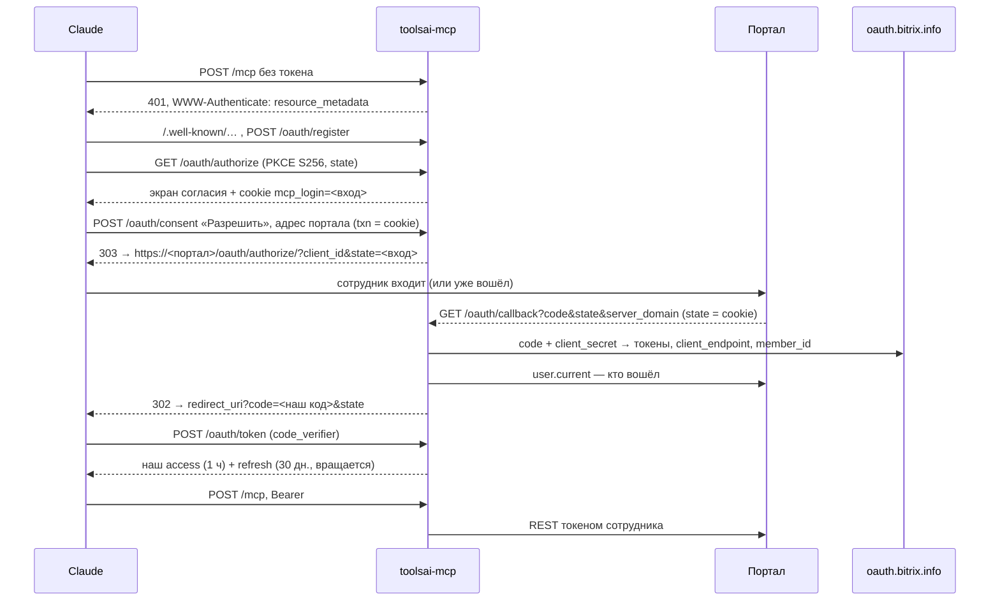

# Устройство

> Last reviewed: 2026-10-16

## Что и зачем

Сотрудник подключает в Claude (или другом MCP-клиенте) коннектор, например
`https://<портал>/mcp-ai/mcp`, называет свой Битрикс24 (облако или коробка — любой домен), входит
своим логином — и ИИ видит в CRM и задачах ровно то, что видит этот сотрудник.
Ни общего токена, ни вебхука: каждый вызов REST идёт его OAuth-токеном.

## Любой Битрикс24

Адрес портала в настройках сервера не нужен. Порядок — штатный «полный протокол OAuth 2.0»
Битрикс24 ([документация](https://apidocs.bitrix24.ru/api-reference/oauth/index.html)):

1. На экране согласия сотрудник вводит адрес портала (`mycompany.bitrix24.by`, `b24.firma.by`;
   браузер запоминает его в cookie `mcp_portal` — только подсказка поля).
2. Браузер уходит на `https://<портал>/oauth/authorize/`. Сам сервер на введённый адрес **не
   ходит** — поэтому произвольный ввод не даёт запросов во внутреннюю сеть.
3. Код меняется на токены у OAuth-сервера из `B24_OAUTH_SERVERS`. Его ответ содержит
   `client_endpoint` (REST портала) и `member_id` (постоянный ID портала) — **им и верим**, а не
   параметрам `domain` и `member_id` в возврате: те браузер может подменить.
4. Токены хранятся по паре «портал (`member_id`) + сотрудник»: сотрудник 7 одного портала и
   сотрудник 7 другого — разные люди.
5. `ALLOWED_USERS` проверяет хост из `client_endpoint` (`портал`, `портал:ID`) или `member_id`
   (`member:<id>`, `member:<id>:ID`), либо `*`. Хост коробки называет её администратор — для коробок
   надёжнее `member_id`.
6. **Внутренняя сеть закрыта.** `client_endpoint` сообщает о себе портал, поэтому: только https и
   имя (не IP, не localhost), имя должно вести только в публичные адреса — проверяется при входе,
   перед каждым вызовом и в момент соединения (свой https-агент), редиректы REST выключены.
   Портал во внутренней сети с этим сервером не работает — для такой коробки сервер ставится на её
   VM и подключается к ней по публичному имени.
7. Сессии старой формы (до «любого портала») не принимаются — после обновления все входят заново.

Чтобы вход работал на многих порталах, `B24_CLIENT_ID` — приложение из партнёрского кабинета
(его `client_id` действует везде, где оно установлено). Локальное приложение работает только на
своём портале — для одного портала этого достаточно.

## Вход

MCP-клиенты входят на удалённый сервер по OAuth 2.1 (спецификация MCP, раздел Authorization):
PKCE, метаданные `/.well-known/…`, динамическая регистрация клиента. Битрикс24 этого не умеет,
поэтому сервер **сам** сервер авторизации для клиента, а внутри `/authorize` отправляет сотрудника
войти в портал через локальное приложение.

| Что | Где живёт | Срок |
|---|---|---|
| Клиент (динамическая регистрация) | Redis `client:<id>` | 30 дней |
| Вход в процессе (`state` для портала) | Redis `login:<случайное>` + cookie браузера | 10 мин, одноразово |
| Наш код авторизации | Redis `code:<sha256>` | 2 мин, одноразово, сгорает и при ошибке |
| Наш access / refresh | Redis `at:` / `rt:<sha256>` — храним хэш, не сам токен | `ACCESS_TTL_SEC` / `REFRESH_TTL_SEC` |
| Токены Битрикс24 сотрудника | Redis `b24:tokens:<member_id>:<userId>` (+ адрес REST портала), refresh зашифрован AES-256-GCM | до `REFRESH_TTL_SEC` |

- Токены Битрикс24 клиенту **не отдаются никогда**.
- Refresh Битрикс24 одноразовый — обновляем под блокировкой на сотрудника (`server/lib/lock.ts`);
  на `expired_token` от REST — повтор после обновления; обновляем, только если в хранилище всё ещё
  отвергнутый access (иначе другой вызов уже обновил — берём его).
- REST идёт через **b24jssdk 3.0.0** (`sdkTransport` в `server/lib/b24.ts`): повтор после
  `expired_token` — его. Лимитер SDK живёт в экземпляре, а экземпляр — на вызов: общего лимита
  на сотрудника он не даёт (issue #2). Обмен кода и refresh — наши (в SDK обмена кода нет, а refresh он
  сливает только внутри одного экземпляра): SDK получает готовый access и наш refresh через
  `setCustomRefreshAuth`. Тесты ходят через `fetchTransport` — те же правила без SDK.
- «Не найдено» портал отдаёт с **пустым** кодом ошибки, а `tasks.task.get` — пустым массивом без
  ошибки (замер 2026-10-13); оба случая инструменты возвращают как «Не найдено», а не как сбой.
- `server_domain` из возврата портала принимаем только из `B24_OAUTH_SERVERS`: иначе подменённый
  возврат отправил бы `client_secret` на чужой сервер.
- Доступ — права администратора портала на `/admin` (коды Битрикс24, `user.access`, [`ACCESS.md`](ACCESS.md)); `ALLOWED_USERS` — необязательный запасной список, `*` — все сотрудники. Пилот: вход открыт только перечисленным ID. Проверяется при входе, при refresh
  и на каждом запросе — убрать сотрудника из списка значит закрыть доступ сразу.
- **Экран согласия и cookie входа.** Регистрация клиентов открыта всем (так требует MCP), поэтому
  без защиты чужой клиент мог бы прислать сотруднику ссылку на портал: тот уже вошёл, портал вернул
  бы код — и код ушёл бы чужому клиенту. Поэтому вход начинается с экрана, где видно имя клиента и
  куда уйдёт ответ, а cookie `mcp_login` (HttpOnly, SameSite=Lax) привязывает вход к браузеру,
  который его начал: согласие и возврат с портала без неё не принимаются.
- Ошибки до проверки `redirect_uri` показываются в браузере, а не уводят на неподтверждённый адрес;
  после проверки — уходят клиенту редиректом с `error` и `state` (RFC 6749 4.1.2.1).
- **Портал отозвал вход** (REST ответил `invalid_token`, refresh не принят) — токены Битрикс24
  удаляются, и наш токен перестаёт работать на следующем же запросе: клиент получит 401 и
  предложит войти заново.

## Права — слоями

1. **Права сотрудника в Битрикс24** — главный слой, его даёт REST.
2. **Scope локального приложения** — сейчас `crm`, `task`, `user`.
3. **`ALLOWED_USERS`** — кому вообще открыт вход.
4. **Узкие инструменты только на чтение** (`annotations.readOnlyHint`), а не «вызвать любой метод».
5. **Журнал** (`make audit`): кто, инструмент, метод REST, имена аргументов, итог, время.
   Значения аргументов и ответы не пишем — там персональные данные.

Запись (шаг 5 плана) — отдельным PR: свой список сотрудников, подтверждение
(`useMcpElicitation()` или «подготовить → выполнить»), журнал «было/стало», удалений нет.

## Инструменты

| Имя | Метод REST |
|---|---|
| `user_current` | `user.current` |
| `crm_deal_list` | `crm.deal.list` (до 50, фильтр как у метода; `next`/`total` — следующая страница) |
| `crm_deal_get`, `crm_lead_get`, `crm_contact_get`, `crm_company_get` | `crm.<сущность>.get` |
| `crm_activity_list` | `crm.activity.list` по владельцу, можно только звонки |
| `task_list`, `task_get` | `tasks.task.list`, `tasks.task.get` |
| `task_checklist`, `task_elapsed`, `task_results` | `task.checklistitem.getlist`, `task.elapseditem.getlist`, `tasks.task.result.list` |
| `task_comments` | `tasks.task.get` → чат задачи `im.dialog.messages.get` (новые задачи) или `task.commentitem.getlist` (старые) |
| `calendar_events`, `calendar_busy` | `calendar.event.get`, `calendar.accessibility.get` |

**Запись в задачи** (`server/plugins/write-tools.ts`) — только тем, кому администратор открыл запись на `/admin`
([`ACCESS.md`](ACCESS.md)); остальные этих инструментов не видят. Изменение отвечает «было → стало», журнал — имена аргументов.

| Имя | Метод REST |
|---|---|
| `task_create`, `task_update` | `tasks.task.add`, `tasks.task.update` (+ `tasks.task.get` для «было») |
| `task_status` | `tasks.task.start` / `pause` / `complete` / `defer` / `renew` |
| `task_checklist_add`, `task_checklist_done` | `task.checklistitem.add`, `task.checklistitem.complete` / `renew` |
| `task_comment_add` | `task.commentitem.add` (у новых задач попадает в чат задачи — проверено) |
| `task_time_add` | `task.elapseditem.add` |

Набор повторяет то, что Битрикс24 сам даёт Марте с разметкой «читает» (`bx-shef/toolsai`,
`docs/private/mcp-box.md` §1.2), но поверх REST.

## Адрес снаружи

Сервер слушает `127.0.0.1:3100`, наружу — через nginx портала (`deploy/bitrixvm/nginx-mcp.conf`):

| Снаружи | В контейнер |
|---|---|
| `/mcp-ai/*` | `/*` |
| `/.well-known/oauth-authorization-server/mcp-ai` (и `openid-configuration`) | метаданные сервера авторизации |
| `/.well-known/oauth-protected-resource/mcp-ai/mcp` | метаданные ресурса |

Метаданные со вставкой пути (RFC 8414, RFC 9728) клиенты ищут в корне хоста — поэтому три точных
`location`, остальной `/.well-known` портала не трогаем. Отвечает их middleware
(`server/middleware/00.auth.ts`): mcp-toolkit сам ставит на эти адреса заглушку 404.

## Риски

- **Связь коробки с облаком.** Обмен кода идёт через `oauth.bitrix.info`: портал должен быть
  зарегистрирован и иметь выход наружу — [`OAUTH_CHECK.md`](OAUTH_CHECK.md), первым делом.
- **Сервер виден из интернета**: TLS портала, `limit_req` в nginx, журнал. Регистрация клиентов
  открыта (так требует MCP), но без входа сотрудника клиент ничего не получает.
- **Подсказки в данных** (prompt injection): текст из CRM попадает в модель — довод держать
  чтение отдельно от записи и спрашивать подтверждение на запись.
- **Долгое бездействие**: refresh Битрикс24 живёт около месяца — потом сотрудник входит заново.
- **Один процесс.** Блокировки — в памяти процесса; второй экземпляр сервера потребует блокировок в
  Redis (`GETDEL`). Перезапуск посреди refresh Битрикс24 может потерять новый refresh — сотрудник
  войдёт заново.
- **Секрет в адресе.** Обмен кода и refresh Битрикс24 — GET с `client_secret` в query (так требует
  Битрикс24): такие адреса не должны попадать в логи прокси между VM и `oauth.bitrix.info`.
- **Redis** — с паролем, без опубликованного порта, `maxmemory 64mb noeviction`: флуд регистраций
  упрётся в отказ записи, а не в падение и не в вытеснение токенов сотрудников. Access-токен
  Битрикс24 (живёт час) лежит в Redis открыто, refresh — зашифрован.

## Инструменты модулей портала

Кроме встроенных инструментов (`server/mcp/tools`), сервер показывает модели функции модулей
портала: модуль регистрирует свои REST-методы и метод-манифест, `MODULE_MANIFESTS` перечисляет
манифесты. На каждый запрос к `/mcp` (хук `mcp:server:created`) сервер читает манифест токеном
сотрудника (кеш 5 минут) и регистрирует инструменты; вызов — в метод модуля от имени того же
сотрудника, только ключи из схемы. Запись и удаление — `WRITE_USERS`. Подробно —
[`MODULE_TOOLS.md`](MODULE_TOOLS.md).

## Иконка коннектора

`GET /icon` отдаёт свою иконку из каталога `branding` на сервере (`icon.png`, `.svg` или `.jpg`,
до 512 КБ) или встроенную; полный адрес и тип уходят клиенту в `icons` при `initialize`
(`server/lib/icon.ts`, `server/plugins/icon.ts`).
