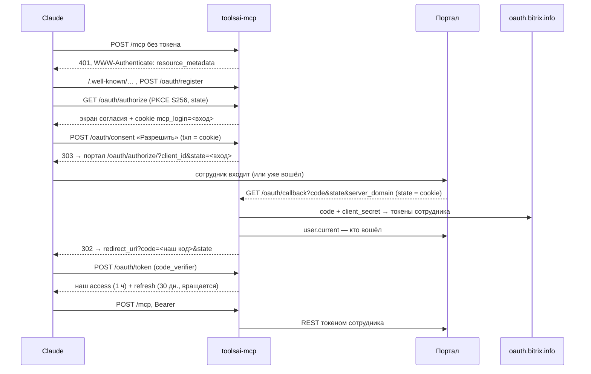

# Устройство

> Last reviewed: 2026-10-13

## Что и зачем

Сотрудник подключает в Claude (или другом MCP-клиенте) коннектор `https://<портал>/mcp-ai/mcp`,
входит своим логином портала — и ИИ видит в CRM и задачах ровно то, что видит этот сотрудник.
Ни общего токена, ни вебхука: каждый вызов REST идёт его OAuth-токеном.

## Вход

MCP-клиенты входят на удалённый сервер по OAuth 2.1 (спецификация MCP, раздел Authorization):
PKCE, метаданные `/.well-known/…`, динамическая регистрация клиента. Битрикс24 этого не умеет,
поэтому сервер **сам** сервер авторизации для клиента, а внутри `/authorize` отправляет сотрудника
войти в портал через локальное приложение.

| Что | Где живёт | Срок |
|---|---|---|
| Клиент (динамическая регистрация) | Redis `client:<id>` | 30 дней |
| Вход в процессе (`state` для портала) | Redis `login:<случайное>` + cookie браузера | 10 мин, одноразово |
| Наш код авторизации | Redis `code:<sha256>` | 2 мин, одноразово, сгорает и при ошибке |
| Наш access / refresh | Redis `at:` / `rt:<sha256>` — храним хэш, не сам токен | `ACCESS_TTL_SEC` / `REFRESH_TTL_SEC` |
| Токены Битрикс24 сотрудника | Redis `b24:tokens:<userId>`, refresh зашифрован AES-256-GCM | до `REFRESH_TTL_SEC` |

- Токены Битрикс24 клиенту **не отдаются никогда**.
- Refresh Битрикс24 одноразовый — обновляем под блокировкой на сотрудника (`server/lib/lock.ts`);
  на `expired_token` от REST — одно принудительное обновление и повтор.
- `server_domain` из возврата портала принимаем только из `B24_OAUTH_SERVERS`: иначе подменённый
  возврат отправил бы `client_secret` на чужой сервер.
- `ALLOWED_USERS` — обязателен (пусто — сервер не стартует), `*` — все сотрудники. Пилот: вход открыт только перечисленным ID. Проверяется при входе, при refresh
  и на каждом запросе — убрать сотрудника из списка значит закрыть доступ сразу.
- **Экран согласия и cookie входа.** Регистрация клиентов открыта всем (так требует MCP), поэтому
  без защиты чужой клиент мог бы прислать сотруднику ссылку на портал: тот уже вошёл, портал вернул
  бы код — и код ушёл бы чужому клиенту. Поэтому вход начинается с экрана, где видно имя клиента и
  куда уйдёт ответ, а cookie `mcp_login` (HttpOnly, SameSite=Lax) привязывает вход к браузеру,
  который его начал: согласие и возврат с портала без неё не принимаются.
- Ошибки до проверки `redirect_uri` показываются в браузере, а не уводят на неподтверждённый адрес;
  после проверки — уходят клиенту редиректом с `error` и `state` (RFC 6749 4.1.2.1).
- **Портал отозвал вход** (REST ответил `invalid_token`, refresh не принят) — токены Битрикс24
  удаляются, и наш токен перестаёт работать на следующем же запросе: клиент получит 401 и
  предложит войти заново.

## Права — слоями

1. **Права сотрудника в Битрикс24** — главный слой, его даёт REST.
2. **Scope локального приложения** — сейчас `crm`, `task`, `user`.
3. **`ALLOWED_USERS`** — кому вообще открыт вход.
4. **Узкие инструменты только на чтение** (`annotations.readOnlyHint`), а не «вызвать любой метод».
5. **Журнал** (`make audit`): кто, инструмент, метод REST, имена аргументов, итог, время.
   Значения аргументов и ответы не пишем — там персональные данные.

Запись (шаг 5 плана) — отдельным PR: свой список сотрудников, подтверждение
(`useMcpElicitation()` или «подготовить → выполнить»), журнал «было/стало», удалений нет.

## Инструменты

| Имя | Метод REST |
|---|---|
| `user_current` | `user.current` |
| `crm_deal_list` | `crm.deal.list` (до 50, фильтр как у метода; `next`/`total` — следующая страница) |
| `crm_deal_get`, `crm_lead_get`, `crm_contact_get`, `crm_company_get` | `crm.<сущность>.get` |
| `crm_activity_list` | `crm.activity.list` по владельцу, можно только звонки |
| `task_list`, `task_get` | `tasks.task.list`, `tasks.task.get` |

Набор повторяет то, что Битрикс24 сам даёт Марте с разметкой «читает» (`bx-shef/toolsai`,
`docs/private/mcp-box.md` §1.2), но поверх REST.

## Адрес снаружи

Сервер слушает `127.0.0.1:3100`, наружу — через nginx портала (`deploy/bitrixvm/nginx-mcp.conf`):

| Снаружи | В контейнер |
|---|---|
| `/mcp-ai/*` | `/*` |
| `/.well-known/oauth-authorization-server/mcp-ai` (и `openid-configuration`) | метаданные сервера авторизации |
| `/.well-known/oauth-protected-resource/mcp-ai/mcp` | метаданные ресурса |

Метаданные со вставкой пути (RFC 8414, RFC 9728) клиенты ищут в корне хоста — поэтому три точных
`location`, остальной `/.well-known` портала не трогаем. Отвечает их middleware
(`server/middleware/00.auth.ts`): mcp-toolkit сам ставит на эти адреса заглушку 404.

## Риски

- **Связь коробки с облаком.** Обмен кода идёт через `oauth.bitrix.info`: портал должен быть
  зарегистрирован и иметь выход наружу — [`OAUTH_CHECK.md`](OAUTH_CHECK.md), первым делом.
- **Сервер виден из интернета**: TLS портала, `limit_req` в nginx, журнал. Регистрация клиентов
  открыта (так требует MCP), но без входа сотрудника клиент ничего не получает.
- **Подсказки в данных** (prompt injection): текст из CRM попадает в модель — довод держать
  чтение отдельно от записи и спрашивать подтверждение на запись.
- **Долгое бездействие**: refresh Битрикс24 живёт около месяца — потом сотрудник входит заново.
- **Один процесс.** Блокировки — в памяти процесса; второй экземпляр сервера потребует блокировок в
  Redis (`GETDEL`). Перезапуск посреди refresh Битрикс24 может потерять новый refresh — сотрудник
  войдёт заново.
- **Секрет в адресе.** Обмен кода и refresh Битрикс24 — GET с `client_secret` в query (так требует
  Битрикс24): такие адреса не должны попадать в логи прокси между VM и `oauth.bitrix.info`.
- **Redis** — с паролем, без опубликованного порта, `maxmemory 64mb noeviction`: флуд регистраций
  упрётся в отказ записи, а не в падение и не в вытеснение токенов сотрудников. Access-токен
  Битрикс24 (живёт час) лежит в Redis открыто, refresh — зашифрован.
